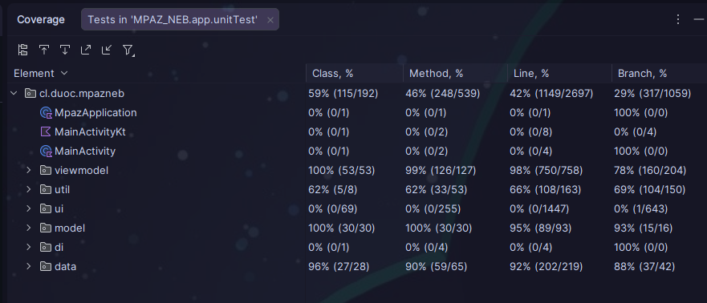

# MPAZ NEB

Aplicación móvil Android de nivelación en **Lectura y Matemática** para estudiantes de 1.º a 4.º básico de la Escuela Escritora Marcela Paz (San Bernardo), conectada a **microservicios Spring Boot** con base de datos **MySQL**.

Proyecto académico (MVP) de la asignatura **DSY1105 – Desarrollo de Aplicaciones Móviles**, Duoc UC. Corresponde a la **Evaluación Parcial 4 (encargo)**.

> **Alcance académico:** la aplicación trabaja únicamente con usuarios, estudiantes, actividades, respuestas y resultados **ficticios**. No diagnostica dificultades de aprendizaje, no asigna notas oficiales y no reemplaza el criterio profesional de docentes, UTP o PIE.

## Integrante

| Nombre | Rol |
|---|---|
| Sebastian Andres Vallejos Rios | Desarrollo de la app móvil, microservicios, pruebas y documentación |

- Docente: Jose Miguel Candia Hernandez
- Sección: 003D

## Enlaces

- Repositorio: [github.com/SebastianVallejos18/MPAZ-NEB](https://github.com/SebastianVallejos18/MPAZ-NEB)
- Planificación en Trello: [[ENLACE AL TABLERO - CLICK]](https://trello.com/invite/b/6ade80a5a3fb6b3ae8006db6/ATTIa81e5618767762904e0fe8d395fe33e24B2800A5/desarrollo-de-aplicaciones-moviles)
- APK firmado: [`apk/MPAZ-NEB-v1.0.apk`](apk/MPAZ-NEB-v1.0.apk)

## Novedades de la Evaluación 4

| Requisito | Implementación                                                                             |
|---|--------------------------------------------------------------------------------------------|
| Microservicios con base de datos | 3 microservicios Spring Boot (`backend/`), cada uno con su propia base MySQL               |
| App conectada a los microservicios | Retrofit + corrutinas; se reemplazó Room por los microservicios (CRUD completo desde la app) |
| API externa | **PokeAPI**: el estudiante gana un Pokémon al terminar una actividad con al menos un acierto |
| Pruebas unitarias | JUnit 4 + MockK + kotlinx-coroutines-test, más pruebas de UI con Compose                   |
| APK firmado | `apk/MPAZ-NEB-v1.0.apk`, firmado con `keystore/equipo8-mpazneb.jks`                        |

## Problema que resuelve

Los materiales de refuerzo de lectura y matemática de la escuela están repartidos en documentos impresos, lo que hace lento buscarlos y adaptarlos al nivel de cada estudiante, y no hay un registro central de qué actividad realizó cada alumno, cuántos intentos necesitó o qué respondió.

MPAZ NEB centraliza las actividades en dos módulos (Lectura y Matemática), permite organizarlas por curso y dificultad, asignarlas de forma supervisada mediante un código temporal, y registrar respuestas, intentos y resultados básicos para orientar el acompañamiento.

## Funcionalidades

### Administración pedagógica (docente o UTP)
- Ingreso con alias y contraseña (validados por el microservicio de usuarios).
- Catálogo de actividades con filtros por módulo, curso, dificultad y estado.
- Crear y editar actividades (nombre, módulo, curso, contenido, objetivo pedagógico, dificultad, instrucciones, texto de lectura, intentos permitidos y estado).
- Crear, editar y eliminar (con confirmación) las preguntas de cada actividad, con tres alternativas, respuesta correcta y retroalimentación.
- Activar la lectura en voz alta para actividades de 3.º básico.

### Asistente de aula
- Ingreso con alias y contraseña.
- Consulta de actividades **disponibles**, filtradas por módulo, curso y dificultad.
- Asignación de una actividad a un estudiante ficticio; el microservicio genera un **código temporal** único de 6 caracteres.
- Resultados de sus asignaciones: estado, intentos, aciertos y respuestas de cada intento.
- Registro de una observación pedagógica general (máximo 300 caracteres).
- **Eliminar una asignación** (con confirmación), junto con sus respuestas.

### Estudiante
- Ingreso solo con el código temporal entregado por la asistente.
- Instrucciones, texto de lectura y preguntas con indicador de avance.
- Confirmación antes de enviar cada respuesta.
- Retroalimentación inmediata, breve y motivadora, sin calificaciones.
- Reintentos cuando la actividad lo permite; si cierra la app a mitad de camino, retoma donde quedó.
- Lectura en voz alta del texto y de las preguntas (según el curso).
- **Premio Pokémon** al terminar con al menos una respuesta correcta.

## Usuarios de prueba (ficticios)

Los crea el microservicio `ms-usuarios` la primera vez que se ejecuta.

| Alias | Contraseña | Perfil | Cómo ingresa |
|---|---|---|---|
| `admin` | `admin123` | Administración pedagógica | Pantalla de inicio de sesión |
| `asistente1` | `asist123` | Asistente de aula | Pantalla de inicio de sesión |
| `estudiante1`, `estudiante2`, `estudiante3` | — | Estudiante | "Soy estudiante" + código que genera la asistente |

`ms-actividades` carga 4 actividades de ejemplo (2 de Lectura y 2 de Matemática, con 12 preguntas en total).

**Flujo sugerido para probar todo:** ingresar como `asistente1`, asignar una actividad a `estudiante1`, anotar el código, cerrar sesión, entrar como estudiante con ese código, responder (al menos una bien para ver el Pokémon) y volver a entrar como `asistente1` para ver los resultados.

## Arquitectura

```
┌──────────────────────────┐          HTTP/JSON (Retrofit)          ┌──────────────────────────────┐
│     App Android (MVVM)   │ ─────────────────────────────────────► │ ms-usuarios      :8081       │──► MySQL mpaz_usuarios
│  Screen → ViewModel →    │ ─────────────────────────────────────► │ ms-actividades   :8082       │──► MySQL mpaz_actividades
│  Repository → Retrofit   │ ─────────────────────────────────────► │ ms-asignaciones  :8083       │──► MySQL mpaz_asignaciones
│                          │                                         └──────────────────────────────┘
│                          │          HTTPS (Retrofit)               ┌──────────────────────────────┐
│                          │ ─────────────────────────────────────► │ PokeAPI (API externa)        │
└──────────────────────────┘                                         └──────────────────────────────┘
```

- La app **nunca accede a la base de datos**: solo consume endpoints REST.
- Cada microservicio es **dueño de sus datos** y tiene su propia base de datos. Las referencias entre microservicios (por ejemplo, `actividadId` dentro de una asignación) se guardan solo como identificadores.
- La app orquesta los tres microservicios; por ejemplo, la pantalla de resultados combina asignaciones, nombres de estudiantes y nombres de actividades.

### App móvil (MVVM + Repository)

| Capa | Paquete | Responsabilidad |
|---|---|---|
| Model | `model` | Modelos de la app y sealed classes (perfil, módulo, dificultad, estados) |
| Remote | `data/remote` | `RetrofitInstance`, interfaces `api/` (una por microservicio y PokeAPI), `dto/` y `Mapeadores.kt` |
| Repository | `data/repository` | Único punto de acceso a los datos; recibe la API por constructor |
| DI | `di/AppModule.kt` | Crea una sola instancia de cada repositorio |
| ViewModel | `viewmodel` | Estado de cada pantalla (`StateFlow`), validaciones y manejo de errores de red |
| View | `ui` | Pantallas y componentes Composable |

- **DTO vs modelo:** los DTO tienen la forma exacta del JSON (los enums viajan como texto); `Mapeadores.kt` los convierte a los modelos de la app. Si cambia el JSON, solo se ajusta ese archivo.
- **Inyección por constructor:** cada ViewModel recibe sus repositorios como parámetros con valor por defecto (`AppModule`). En las pruebas se reemplazan por mocks de MockK.
- **Errores de red:** `util/Errores.kt` traduce las excepciones a mensajes para el usuario: sin conexión (`IOException`) o el campo `mensaje` que envía el microservicio (`HttpException`). Las listas muestran un aviso con botón **Reintentar**.
- **Reglas de validación** como funciones puras (`util/validaciones.kt`).

### Estructura de carpetas

```
MPAZ-NEB/
├── app/src/main/java/cl/duoc/mpazneb
│   ├── data
│   │   ├── remote                // RetrofitInstance, api/, dto/, Mapeadores, Llamadas
│   │   └── repository            // Usuario, Actividad, Asignacion y Pokemon
│   ├── di                        // AppModule
│   ├── model                     // Modelos y sealed classes
│   ├── ui                        // components, navigation, screens, theme
│   ├── util                      // Validaciones, reglas, errores, LectorVoz, Vibrador
│   └── viewmodel                 // ViewModels y estados de pantalla
├── app/src/test                  // Pruebas unitarias
├── app/src/androidTest           // Pruebas de UI (Compose)
├── backend                       // Microservicios Spring Boot
├── keystore/equipo8-mpazneb.jks  // Llave de firma
├── keystore.properties           // Configuración de la firma
└── apk/MPAZ-NEB-v1.0.apk         // APK firmado
```

## Microservicios (backend)

Tres aplicaciones Spring Boot 3.5 (Java 17) independientes, agrupadas en `backend/pom.xml` para abrirlas como un solo proyecto. Detalle en [`backend/README.md`](backend/README.md).

Cada microservicio sigue la estructura `model` (entidades JPA) → `repository` (Spring Data JPA) → `service` (reglas de negocio) → `controller` (endpoints REST), con `dto` (cuerpos de petición validados con `@Valid`) y `exception` (`@RestControllerAdvice` que responde `{"mensaje": "...", "estado": 404}`).

### ms-usuarios (puerto 8081)

| Método | Endpoint | Descripción |
|---|---|---|
| GET | `/api/usuarios?perfil=ESTUDIANTE` | Lista usuarios (filtro opcional) |
| GET | `/api/usuarios/{id}` | Busca un usuario |
| POST | `/api/usuarios/login` | Login: 200 con el usuario o 401 |
| PATCH | `/api/usuarios/{id}/acceso` | Registra el último acceso |
| POST | `/api/usuarios` | Crea un usuario |
| PUT | `/api/usuarios/{id}` | Edita un usuario |
| DELETE | `/api/usuarios/{id}` | Elimina un usuario |

### ms-actividades (puerto 8082)

| Método | Endpoint | Descripción |
|---|---|---|
| GET | `/api/actividades?modulo=&curso=&dificultad=&estado=` | Lista con filtros opcionales |
| GET | `/api/actividades/{id}` | Busca una actividad |
| POST | `/api/actividades` | Crea una actividad |
| PUT | `/api/actividades/{id}` | Edita una actividad |
| DELETE | `/api/actividades/{id}` | Elimina (solo en borrador) |
| GET | `/api/actividades/{id}/preguntas` | Preguntas de una actividad |
| POST | `/api/actividades/{id}/preguntas` | Agrega una pregunta |
| GET / PUT / DELETE | `/api/preguntas/{id}` | Busca, edita o elimina una pregunta |

### ms-asignaciones (puerto 8083)

| Método | Endpoint | Descripción |
|---|---|---|
| GET | `/api/asignaciones?asistenteId=` | Asignaciones de una asistente |
| GET | `/api/asignaciones/{id}` | Busca una asignación |
| GET | `/api/asignaciones/codigo/{codigo}` | Ingreso del estudiante con su código |
| POST | `/api/asignaciones` | Crea la asignación y genera el código temporal |
| PUT | `/api/asignaciones/{id}` | Guarda el avance (estado, intentos, aciertos, errores) |
| PATCH | `/api/asignaciones/{id}/observacion` | Guarda la observación de la asistente |
| DELETE | `/api/asignaciones/{id}` | Elimina la asignación y sus respuestas |
| GET | `/api/asignaciones/{id}/respuestas?intento=` | Respuestas (intento opcional) |
| POST | `/api/asignaciones/{id}/respuestas` | Guarda una respuesta y suma acierto/error (transacción) |

## API externa: PokeAPI

- Endpoint: `GET https://pokeapi.co/api/v2/pokemon/{id}` (pública, sin clave).
- Implementación: `PokeApiService` → `PokemonRepository` → `SesionEstudianteViewModel` → `TarjetaPokemon`.
- Al llegar a la pantalla de resultado, si el estudiante tuvo **al menos un acierto**, se elige un Pokémon al azar de la primera generación (1 a 151) y se muestra su imagen (cargada con **Coil**), número, nombre y tipos traducidos al español.
- **No interfiere con los datos propios:** no guarda nada en los microservicios, y si la PokeAPI falla la sesión termina normalmente sin el premio.

## Cómo ejecutar

### Requisitos
- MySQL en `localhost:3306` (XAMPP o MySQL Server).
- JDK 17 o superior e IntelliJ IDEA (para los microservicios).
- Android Studio compatible con Android Gradle Plugin 9.4.1.
- Teléfono Android 8.0 (API 26) o superior con **Depuración USB**, o un emulador.

### 1. Microservicios
1. Encender MySQL. Las bases `mpaz_usuarios`, `mpaz_actividades` y `mpaz_asignaciones` se crean solas.
2. En IntelliJ: **File → Open → `backend/pom.xml` → Open as Project**.
3. Ejecutar `UsuariosApplication`, `ActividadesApplication` y `AsignacionesApplication`.
4. Comprobar en el navegador: `http://localhost:8081/api/usuarios`, `http://localhost:8082/api/actividades`, `http://localhost:8083/api/asignaciones`.

Si MySQL usa otro usuario o clave, se cambia en `src/main/resources/application.properties` de cada microservicio.

### 2. App en un teléfono físico (USB)
1. Abrir la raíz del proyecto en Android Studio y esperar **Sync Gradle**.
2. Conectar el teléfono y crear un túnel por USB para cada microservicio (PowerShell):
   ```powershell
   $adb = "$env:LOCALAPPDATA\Android\Sdk\platform-tools\adb.exe"
   & $adb reverse tcp:8081 tcp:8081
   & $adb reverse tcp:8082 tcp:8082
   & $adb reverse tcp:8083 tcp:8083
   ```
   Así, `127.0.0.1` dentro del teléfono apunta al computador. Los túneles se pierden al desconectar el cable.
3. Presionar **Run** (▶).

**Otras opciones** (constante `IP_SERVIDOR` en `data/remote/RetrofitInstance.kt`):
- Emulador de Android Studio: `10.0.2.2`.
- Teléfono por Wi-Fi en la misma red: la IP del computador (`ipconfig`), permitiendo Java en el firewall.

En Logcat, filtrando por `okhttp`, se ve cada petición y su respuesta JSON.

## Pruebas

### Pruebas unitarias (`app/src/test`)
JUnit 4 + **MockK** + **kotlinx-coroutines-test**, con `MainDispatcherRule` para reemplazar `Dispatchers.Main`.

| Paquete | Qué se prueba |
|---|---|
| `util` | Validaciones, reglas (voz por curso, premio), etiquetas y traducción de errores de red |
| `model` | Conversión de los textos del JSON a sealed classes |
| `data/remote` | Mapeadores DTO ↔ modelo y conversión de 404 a `null` |
| `data/repository` | Los 4 repositorios con la API de Retrofit simulada con MockK |
| `viewmodel` | Los 11 ViewModels: casos exitosos, validaciones, errores del servidor y sin conexión |

Ejecutar: clic derecho en `app/src/test/java` → **Run 'Tests in java' with Coverage**.

**Cobertura de la lógica (líneas):** `viewmodel` 98 % · `data` 92 % · `model` 95 % · `util` 66 % → **≈ 93 % en total**.



La cobertura de `util` es menor porque incluye `LectorVoz` y `Vibrador`, que usan hardware del teléfono (texto a voz y vibración); en las pruebas se reemplazan por mocks. Las pantallas (`ui`) se verifican con pruebas de UI.

### Pruebas de UI (`app/src/androidTest`)
Pruebas con `createComposeRule` para `MensajeError` y `TarjetaPokemon`. Se ejecutan con el teléfono conectado: clic derecho en `app/src/androidTest/java` → **Run**.

## APK firmado

- APK: [`apk/MPAZ-NEB-v1.0.apk`](apk/MPAZ-NEB-v1.0.apk) (versión 1.0, build *release*).
- Llave: `keystore/equipo8-mpazneb.jks`, alias `mpazneb`.
- Configuración: bloque `signingConfigs` de `app/build.gradle.kts`, que lee los datos de `keystore.properties`.

**Cómo se generó la firma:**
1. Android Studio → **Build → Generate Signed App Bundle or APK → APK**.
2. **Create new…**: ruta `keystore/equipo8-mpazneb.jks`, contraseña, alias `mpazneb`, validez de 25 años y datos del certificado.
3. Variante **release** → **Create**. Android Studio genera `app/release/app-release.apk`.
4. El APK se copió a `apk/MPAZ-NEB-v1.0.apk`.

Con `keystore.properties` configurado también se puede generar desde la terminal con `./gradlew assembleRelease`.

> En un proyecto real, la llave `.jks` y sus contraseñas no se suben al repositorio; aquí se incluyen porque la evaluación lo solicita.

## Formularios y validaciones

Cada campo muestra su error con **color, ícono de advertencia y mensaje**, y el botón de guardar queda deshabilitado mientras se procesa. Si un campo ya tenía error, se revalida mientras el usuario lo corrige. Los microservicios validan nuevamente con `@Valid` y responden con un mensaje que la app muestra.

- **Login:** alias (3 a 20 caracteres, letras, números o guion bajo) y contraseña (mínimo 6).
- **Actividad:** nombre, contenido, objetivo, instrucciones, texto de lectura (obligatorio solo en Lectura) e intentos permitidos (1 a 5).
- **Pregunta:** enunciado, tres opciones **distintas entre sí**, retroalimentación y procedimiento (obligatorio solo en Matemática).
- **Código del estudiante:** 6 caracteres, siempre en mayúscula.

## Reglas de negocio

- Una actividad sin preguntas no puede quedar en estado **Disponible** (validado en la app y en `ms-actividades`).
- No se puede eliminar la única pregunta de una actividad disponible.
- La asistente solo ve actividades **disponibles**.
- El código temporal lo genera `ms-asignaciones`: es único y no usa caracteres que se confunden (sin `0`/`O` ni `1`/`I`/`L`).
- El código deja de funcionar cuando la asignación se finaliza.
- Cada respuesta y la suma de aciertos/errores se guardan en una **transacción** (`@Transactional`) en el microservicio.
- Las contraseñas se guardan con hash SHA-256 en `ms-usuarios` y nunca viajan de vuelta a la app.
- El administrador y la asistente no pueden modificar resultados; la asistente solo registra observaciones generales.

## Animaciones

| Animación | Dónde | Aporte |
|---|---|---|
| Transición entre pantallas (deslizamiento y fundido, 300 ms) | Toda la navegación | Indica si el usuario avanzó o retrocedió |
| `AnimatedVisibility` | Errores del login, campos condicionales de formularios, retroalimentación | Los elementos aparecen y desaparecen con suavidad |
| `animateFloatAsState` | Barra de progreso del estudiante | Muestra el avance con fluidez |
| `animateColorAsState` | Opción de respuesta elegida | Confirma la selección |
| Indicadores de carga | Login, formularios, listas y premio Pokémon | Informan que se está consultando a un servidor |

## Recursos nativos del dispositivo

### Texto a voz (parlante)
- `TextToSpeech` de Android, encapsulado en `util/LectorVoz.kt`.
- **Regla por curso:** siempre activo en 1.º y 2.º básico; en 3.º básico solo si el administrador lo activa; no disponible en 4.º básico.
- Lee las instrucciones, el texto, cada pregunta con sus alternativas y la retroalimentación, a velocidad reducida (0,85).
- No requiere permisos de ejecución; se declara `<queries>` para `TTS_SERVICE` (Android 11+).

### Vibración
- `Vibrator` / `VibrationEffect`, encapsulado en `util/Vibrador.kt`.
- Un toque firme al acertar y dos toques suaves al responder algo por reforzar.
- Permiso `android.permission.VIBRATE` (normal, se concede al instalar), con tope de seguridad de 500 ms.

### Red
- Permiso `android.permission.INTERNET` para los microservicios y la PokeAPI.
- `usesCleartextTraffic="true"` porque los microservicios locales usan HTTP; la PokeAPI usa HTTPS.

## Tecnologías

**App:** Kotlin 2.2.10 · Jetpack Compose · Material Design 3 · Navigation Compose 2.9.8 · ViewModel, StateFlow y corrutinas · Retrofit 3.0.0 + Gson · OkHttp Logging Interceptor · Coil 2.7 · Android Gradle Plugin 9.4.1 · compileSdk 37 · minSdk 26

**Backend:** Java 17 · Spring Boot 3.5 (Web, Data JPA, Validation) · Hibernate · MySQL 8 · Maven

**Pruebas:** JUnit 4 · MockK · kotlinx-coroutines-test · Compose UI Test

## Trabajo colaborativo

- Control de versiones en GitHub, con commits técnicos por etapa: microservicios → conexión con Retrofit → PokeAPI → pruebas → APK firmado y documentación.
- Planificación y seguimiento de tareas en Trello (enlace más arriba).

## Limitaciones y mejoras futuras

- Datos exclusivamente ficticios y una secuencia reducida de actividades por módulo.
- Los microservicios corren en un computador local; como mejora se propone desplegarlos en la nube y agregar un **API Gateway** con una sola URL de entrada.
- La comunicación local usa HTTP; en producción se usaría HTTPS y autenticación con tokens (por ejemplo, JWT).
- El hash de contraseñas es SHA-256 sin sal; en producción se usaría BCrypt.
- Sin integración con sistemas institucionales ni uso de inteligencia artificial para generar contenido.
- No evalúa lectura en voz alta ni reemplaza la evaluación oficial.
